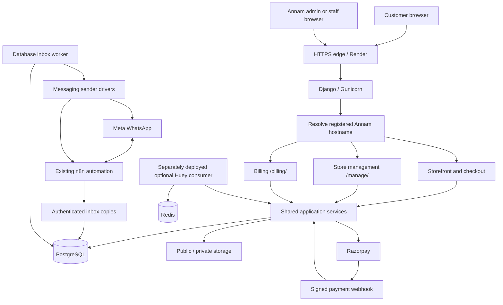
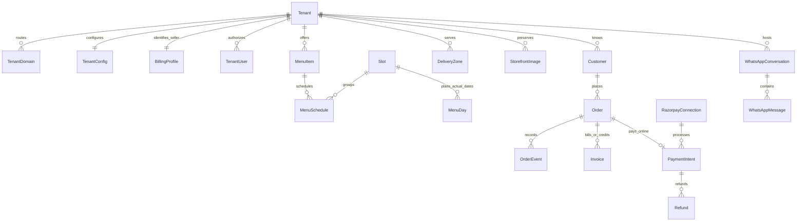
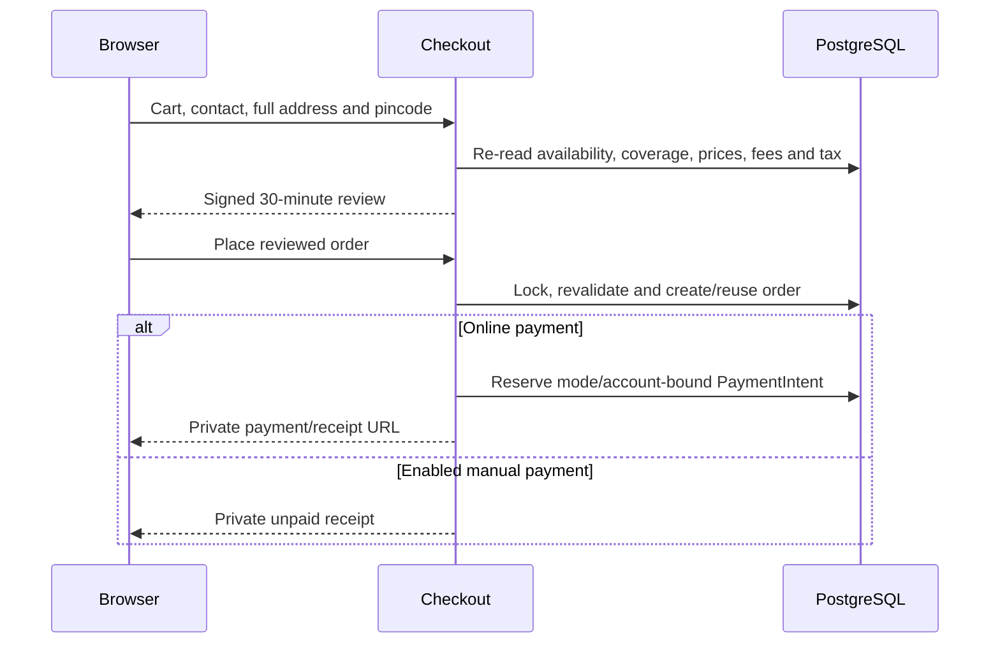

# Annam Foods application architecture

Current scope: **22 October 2026**. This application now serves **Annam Foods
only**, following the decision to retire the SEER cloud-kitchen platform product.
This document describes repository behavior; it does not certify a live Render
release, actual provider credentials, payment transaction or DNS change.

## 1. Scope and conversion

The application remains a modular Django monolith with PostgreSQL, server-rendered
pages and progressive JavaScript. It is Annam's storefront and management system.

| Kept | Removed from the active application |
| --- | --- |
| Annam storefront and saved published design | SEER login, branding and marketing pages |
| Menu/shop, cart and pincode-checked checkout | Kitchen picker and workspace dashboard |
| Existing admin accounts and store membership | Browser tenant provisioning and owner-invitation screens |
| Catalog, banners, pages and normal store settings | Domain-management/verification/activation screens and certificate/proof endpoints |
| Delivery/courier policy, orders and fulfilment | Appearance visual editor, render/upload/publish endpoints and editor assets |
| Razorpay, private receipts/bills and full refunds | Workspace-based access that could select another store |
| WhatsApp inbox/n8n sync and billing | Exposed Django `/admin/` interface |

There is **no destructive database migration**. Existing store IDs, scoped foreign
keys, users, catalog, published text/photos, payment references, invoices and
history remain. Preserved tenant-scoping infrastructure is an internal data
boundary, not a customer-facing multi-kitchen product.

## 2. System overview



There is no separate SPA or requirement for WordPress/WooCommerce. The
`wordpress/` directory is an older independent review prototype, not the live
Django catalog/order/billing database.

## 3. Access and routing

### Login and authorization

Annam's admin login is `/manage/login/`; opening `/manage/` while signed out
redirects there. Valid credentials lead directly to `/manage/` or a safe local
management destination. There is no SEER account picker or platform login form.

Existing Django users and `TenantUser` membership remain. Active owner, manager
and staff memberships authorize appropriate store tools. Active superusers can
use the same login; sensitive payment/refund actions still require owner or
superuser permission. An unrelated/inactive account does not gain store access.
Billing retains its separate `/billing/login/` entry point with the existing
accounts. Browser mutations require CSRF protection.

### Current routes

| Surface | Route |
| --- | --- |
| Storefront | `/`, `/menu/`, `/shop/`, `/item/<id>/`, `/about/`, `/p/<slug>/` |
| Cart / checkout | `/cart/`, `/checkout/` |
| Private receipt | `/checkout/complete/<uuid>/` |
| Payment begin/page/verify/status | Receipt path plus `pay/`, `payment/`, `verify/`, `status/` |
| Customer bill | Receipt path plus `bill/` |
| Store admin | `/manage/` |
| Orders | `/manage/orders/` |
| WhatsApp inbox/settings | `/manage/whatsapp/`, `/manage/whatsapp/settings/` |
| Razorpay settings | `/manage/payments/razorpay/` |
| Checkout/courier settings | `/manage/checkout-settings/` |
| Legal billing settings | `/manage/billing/` |
| Store settings | `/manage/settings/` |
| Billing portal | `/billing/` |
| Database health probe | `/healthz` |

### Compatibility URLs

The previously configured provider and image URLs remain stable:

- `/platform/webhooks/annam/razorpay/test/` and `/live/`.
- `/platform/webhooks/annam/whatsapp/` and `/whatsapp/n8n/`.
- `/webhooks/whatsapp/` and `/webhooks/whatsapp/n8n/` on the store hostname.
- `/platform/assets/annam/<uuid>/` for existing published editor images.

The `platform` segment in these technical paths does not expose a platform UI.
Callbacks authenticate independently. The former configured platform hostname can
still accept exact signed/authenticated callbacks for the configured store, but
cannot show a login, storefront or administration page without a store mapping.

Old SEER login/home GET bookmarks redirect to `/manage/login/`. Annam workspace
GET bookmarks translate to local `/manage/`, `/billing/` or storefront routes.
Cross-store workspace slugs, traversal/external redirect attempts and removed
domain/editor/provisioning routes are refused. Old POST submissions receive no
redirect/replay into replacement endpoints. Login never accepts an external
`next` destination.

## 4. Store resolution and retained data isolation

`TenantMiddleware` resolves the registered hostname to the existing store record.
Production defaults to `STORE_SLUG=annam`; a hostname mapped to a historical other
store is refused. URL slugs cannot switch the browser's store. Background inbox,
periodic jobs and payment reconciliation also filter to `STORE_SLUG`.

Missing/unknown hosts fail closed; `/healthz` is the host-independent exception.
Existing connected custom hosts may retain admission through their saved mapping;
pending claims no longer admit traffic. No automatic custom-domain setup, primary
switch or certificate issuance is exposed. Future DNS/hosting configuration is an
operator task.

Tenant-owned models still inherit `TenantOwnedModel`:

```python
Order.objects.all()      # scoped to the active store; raises without context
Order.all_tenants.all()  # explicit internal cross-store operation
```

The context uses `ContextVar`; requests/jobs set it deliberately and restore it
and the active timezone afterward. Scope checks are enforced in application code
and tests, not PostgreSQL row-level security. Development without `STORE_SLUG`
can test preserved isolation with multiple fixture stores; it never re-enables
removed UI routes.

## 5. Module responsibilities

| Module | Responsibility |
| --- | --- |
| `apps.tenancy` | Existing store/configuration/membership, scoped managers/context, encrypted connections and deployment filtering |
| `apps.catalog` | Meal slots, categories/items, weekly/dated schedules and availability |
| `apps.delivery` | Meal zones and separate exact-pincode courier policy |
| `apps.content` | Pages/banners, published-design rendering, stored images and media fallback |
| `apps.storefront` | Public pages, cart, guest checkout, private confirmation and trusted theme templates |
| `apps.orders` | Customers/addresses, pricing/order snapshots and fulfilment events |
| `apps.billing` | Staff bookings, payment confirmation, tax, invoice/credit numbering and printing |
| `apps.payments` | Razorpay settings, provider adapter, capture/webhook verification, refunds and reconciliation |
| `apps.messaging` | Inbox ingestion/receipts, authenticated sync, outbound queue and sender drivers |
| `apps.owner` | Annam's login/dashboard/catalog/content/order/settings UI |
| `apps.jobs` | Periodic message dispatch and local business-day handoff |
| `apps.platform_portal` | Retained compatibility asset/webhook routes and safe old-bookmark redirects; internal historical services remain unexposed |
| `config` | Settings, root routing, WSGI and health check |

Services own business rules; views authorize/parse and render. Modules call shared
Python services instead of internal HTTP endpoints. Templates do not calculate
financial totals or decide whether a delivery address is eligible.

## 6. Persistence model



The diagram shows principal relationships, not every field. Important sources of
truth:

- `TenantConfig`: store identity/theme/features, saved design and checkout policy.
- `BillingProfile`: legal seller, address, FSSAI/GST, tax and rounding rules.
- `Order`: placed customer/address/line/pricing snapshots, channel/source,
  fulfilment and payment state. Historical prices do not follow catalog edits.
- `InvoiceSequence` / `Invoice`: locked financial-year numbering and immutable
  issued bill/credit snapshots.
- `RazorpayConnection` / `PaymentIntent` / `Refund` / `PaymentEvent`: encrypted
  account settings, mode-bound provider references, financial state and deduplication.
- `WhatsAppMessage` / `WhatsAppReceipt` / outbound/forward queues: conversation
  bodies, status history and durable delivery work.

Money uses `Decimal` and decimal database fields. Conversion to integer paise
occurs only at the payment boundary. Historical domain claims, invitations and
audit rows are retained, but have no public management/activation interface.

## 7. Storefront, published content and media

The existing Kitchen Classic templates continue rendering Annam's published
section order, visibility, text, colors, footer and photo references. No reset or
replacement theme is applied. The Appearance UI, live canvas, editor upload,
render/save/publish routes and SEER/editor assets are removed.

`TenantConfig.storefront_design` remains because it contains the existing public
website. Only its **published** state is rendered; an old `?design=draft` query
cannot reveal unpublished content, even for signed-in staff. Saved draft/previous
records remain untouched. Existing catalog, banners, pages and normal store
settings remain editable in their own forms.

Published editor images remain `StorefrontImage` database binary records with
their existing UUID URLs. Public references stay readable after deployment;
unpublished images remain staff-protected. A cross-store image slug is not a
browser store selector. Existing upload validation/services remain internal for
data compatibility, not an exposed editor.

Legacy dish/banner/brand files use public media storage. Selected recovered files
under `static/public-media/` are fallback assets, including Health Mix. An owner's
existing uploaded replacement takes precedence. A fallback file set does not make
every upload durable on an ephemeral hosting disk.

Published customer-facing footer overrides remain separate from the legal
`BillingProfile`; retaining a marketing address must not rewrite issued invoice
seller details.

## 8. Catalog, cart and delivery rules

The admin catalog separates **Meals** from **Other items**. Breakfast/Lunch/Dinner
can be planned for an actual calendar date (Today/Tomorrow/date picker). Staff use
**Choose dishes** to select existing meals and save a full date menu without
creating duplicate products. Date-specific additions/removals change that date
only; a date removal never deletes the catalog item or disables it globally.
**All dishes** retains catalog/weekly editing, and Not assigned retains dishes
without schedules. Imported category names remain historical labels.

`MenuDay` records the explicitly saved date/meal and revision. When present,
`resolve_menu` uses dated schedule rows only: an empty saved menu never falls
back to weekly rows. Without a saved plan, existing weekly/dated schedules continue
with a review notice in management. Existing live menus are not bulk rewritten
based on imported Tuesday/Friday labels. New imports create no guessed seven-day
schedules; staff select and save real menus. Publication is transactional under
the store configuration lock, validates store ownership and rejects stale saves.
Existing dated price overrides, stock limits and sold counters are preserved.

The shared resolver drives the customer website, cart and order pricing, so an
item removed from a saved day's menu cannot be ordered for that date. Order and
invoice history remains unchanged. Product name/base price/global visibility are
still catalog settings; the dated availability control is separate.

| Fulfilment | Rules |
| --- | --- |
| Scheduled breakfast/lunch/dinner | Mandatory pincode in an active delivery zone for that meal, chosen slot/date, live schedule, cutoff, closed dates, zone minimum/fee |
| Courier shop items | Courier feature/configuration enabled, exact approved Tamil Nadu pincode, courier minimum and shipping fee |

Dated schedules override weekday schedules. Inactive/unavailable/sold-out items
cannot be ordered. Prices and eligibility are re-read on the server.

The session cart is namespaced by store (`cart.<id>`), validates quantities/types
and caps quantities at 99 per line. One cart contains one meal slot/date or
courier goods; mixed fulfilment is refused. Checkout supports its implemented
today/tomorrow meal selection.

Out-of-zone customers cannot place a meal order. Courier delivery uses an
explicit exact-pincode allowlist, not a guessed statewide prefix. It fails closed
until configured. Website checkout offers no silent pickup/coverage bypass;
staff collection booking remains a separate workflow.

## 9. Guest checkout and order creation



The review binds store, browser identity, customer/cart details, coverage/prices,
tax/fees and payment mode/account. Changes require a new review. Duplicate
submission reuses the order via transactional locking and a unique external
reference; replay must not clear a newer cart.

Customers provide name, Indian phone, optional email, complete address, city and
pincode. A phone number does not grant access to a previous customer's history
or private details. Receipt/bill URLs are UUID-based and bound to the purchasing
browser session and store. No customer OTP/account history is implemented.

Website orders use `channel=web`, `source=storefront`. Staff manual and WhatsApp
bookings share the same `Order`, pricing and billing services.

Fulfilment follows `placed → confirmed → preparing → out_for_delivery → delivered`,
with cancellation before terminal states and event history. Payment state is
separate: pending/COD pending, paid, failed or refunded. Delivery never proves
payment; cancellation does not automatically refund money.

## 10. Razorpay architecture

Owner-only settings hold separate encrypted test/live connections, with one
active mode offered to new customers. Enabling verifies credentials through a
read-only provider request. Saved legacy credentials migrate disabled.

Each intent preserves store, order, connection/mode/Key ID, exact paise amount
and INR currency. Existing orders retain their original mode when settings change.
Replacing keys while open provider orders require them is blocked.

Payment flow:

1. Claim provider-order creation transactionally and call the bounded HTTPS
   adapter outside the database lock.
2. Use a stable receipt/reference. Unknown creation outcomes reconcile by receipt
   rather than blindly creating another provider order.
3. Load Razorpay Checkout with public options and customer-entered prefill only.
4. Verify browser HMAC against the stored order reference, then independently fetch
   exact order/amount/INR/captured status before recording payment.
5. Verify raw webhook HMAC with mode-specific secrets; deduplicate event IDs and
   fetch independent provider evidence. Delayed failures cannot downgrade paid or
   refunded state.

Supported events: `payment.captured`, `payment.failed`, `order.paid`,
`refund.created`, `refund.processed`, `refund.failed`. Authorization alone remains
unpaid. Capture after cancellation records funds without reopening fulfilment and
flags refund review. Staff cannot manually bypass online verification.

Live capture attempts one invoice. Billing failure leaves verified funds recorded
and surfaces a repairable billing notice. Test orders have TEST labels and cannot
issue real numbered bills. No card, UPI PIN or bank credentials are stored.

Full refunds require owner permission, reason and confirmation. Request UUIDs,
provider idempotency and lookups reconcile pending/unknown results without a new
refund action. Only fetched `processed` refund records prove completion; a
reported refunded amount alone is insufficient. External partial refunds require
review and block a blind additional full refund. Full processed refunds create
remaining eligible credit-note value, accounting for prior credits.

Customers/owners can refresh payment state. `reconcile_razorpay` is a bounded
read/reconciliation command for an external scheduler; it does not create a charge
or refund. It is not automatically installed as Render cron.

Actual Annam sandbox/live verification still needs secure keys, public webhook
configuration and acceptance. Live use additionally requires activation/KYC and
explicit enabling. See [docs/razorpay.md](docs/razorpay.md).

## 11. Billing

The separate Manual/Website/WhatsApp billing screens share legal profile,
numbering, payment checks and issued documents. Staff bookings start unpaid;
manual/COD confirmation records actual receipt, not bank verification.

Billing supports regular GST invoices, composition bills of supply and
unregistered bills. Configured tax rules cover inclusive/exclusive prices,
item/default rates, CGST/SGST or IGST, delivery tax and rounding. Seller settings
must reflect actual accountant-approved details.

Issuance requires an eligible paid order, validates the total against payment,
snapshots seller/buyer/lines/payment, allocates a financial-year/series number
under a row lock and reuses that invoice on retries. Issued documents retain their
original values. Credits correct/refund documents rather than silently editing
old bills. View/print uses a shared layout and browser Print / Save as PDF.
Automatic generated-PDF WhatsApp delivery remains separate work.

## 12. WhatsApp and n8n

The existing n8n automation remains. Inbox sync requires Meta phone number ID and
an encrypted bearer sync token. n8n keeps its existing Meta callback and posts
incoming/status copies plus each successfully sent outgoing body/provider ID to
the inbox. Delivery callbacks alone do not contain outgoing reply text.

Sync deduplicates provider IDs and reconciles receipts arriving before message
bodies. Retry copy nodes, not the actual send operation. The sync route does not
forward copies back to n8n, avoiding loops. Direct Meta ingestion is separately
signed; media/sending connections have their own requirements. An app secret is
not required merely for n8n-to-inbox mirroring.

The inbox stores messages/attachments and delivery/read/failed status. Staff
replies require an open 24-hour customer window and configured sender. Media
previews require server-side connection access. Old history is not auto-imported.

The database inbox worker handles staff replies/forward events without Redis.
Other outbound transactional dispatch uses the separately deployed Huey periodic
consumer. Sender drivers own provider I/O and payload constraints; queue records,
leases, backoff and bounded retries preserve delivery history.

Mirroring does not automatically create a billable order. Staff can open a
WhatsApp booking with contact details prefilled. Structured automatic order import,
complete native chat ordering and automatic bill delivery remain separate work.
Live incoming/outgoing/status sync still needs verification.
See [docs/n8n/inbox-sync.md](docs/n8n/inbox-sync.md).

## 13. Runtime, storage and operations

Local development uses PostgreSQL and optional Redis via `compose.yaml`.
Production uses Django/Gunicorn and WhiteNoise static files.

```text
build.sh: install requirements → collectstatic
start.sh: migrate → optional background seed/media restore → supervisor
scripts/serve_with_inbox.py:
  ├─ Gunicorn: 2 workers, timeout 60 seconds, PORT or 10000
  └─ manage.py run_whatsapp_worker
```

The supervisor exits/restarts when either child fails. It does not run Huey or
payment reconciliation. `/healthz` checks `SELECT 1`; it cannot prove external
payment/n8n/media/worker health.

| Storage | Contents and requirement |
| --- | --- |
| PostgreSQL | Store/catalog/orders/invoices/payment/inbox records, sessions and editor image bytes; back up and test restore |
| Public media | Legacy dish/banner/brand files; durable disk/shared storage required |
| Static assets | Collected CSS/JS/icons and selected bundled recovery files |
| Private storage | Bill artifacts if used; never mount as public media |
| Redis | Optional Huey broker; needs a consumer to run periodic jobs |
| Encrypted database fields | Provider secrets; preserve the matching encryption key |

`render.yaml` is a free demo blueprint with ephemeral `/tmp` media and sleeping
service behavior. `render.paid.yaml` defines a paid database and persistent
`/var/data` disk; this does not claim it is deployed. Both configure
`STORE_SLUG=annam`. Existing database names/encryption keys are not renamed.
Provider availability/cost/lifecycle limits require account-level verification.

Production needs database settings, `SECRET_KEY`, `SECRETS_KEY`, `ALLOWED_HOSTS`
and trusted HTTPS origins. `PLATFORM_HOST` is optional legacy callback support,
not a login surface. Domain automation credentials/settings are no longer needed
for normal Annam operation; registrar/hosting changes remain external.

Keep keys stable across deployments. Lost encryption keys make saved provider
connections unreadable even if the database is restored. Use durable storage,
monitor queues/provider callbacks, schedule reconciliation if desired and test
restoration of records, images, credentials and invoice history.

Before horizontal scaling, legacy files must use storage shared between instances;
a single mounted disk does not provide that automatically. Database image storage
also increases database/backup size.

## 14. Security and failure handling

- Preserve scoped managers, server-side membership checks and context cleanup.
- Protect browser mutations with CSRF; provider webhooks authenticate separately.
- Never trust browser prices, payment flags or arbitrary receipt references.
- Keep secrets encrypted/write-only; sanitize provider failures and avoid secrets
  or customer/receipt data in logs.
- Require exact provider evidence, financial uniqueness and row locks for captures,
  invoices and refunds; ambiguous outcomes require reconciliation.
- Refuse unknown hosts, other-store routes, unsafe old bookmark redirects and
  retired mutations. Published content remains escaped/validated.
- Production uses secure cookies, HTTPS redirect and HSTS. A retention/deletion
  policy, monitoring and restore runbook remain operational responsibilities.

| Failure | Recovery |
| --- | --- |
| Stale checkout review | Re-review current prices/coverage before ordering |
| Duplicate submission | Return the existing order |
| Provider timeout | Preserve uncertain state; reconcile instead of new financial action |
| Verified payment / invalid billing profile | Keep paid state, repair profile and generate bill |
| Failed n8n copy | Retry only the copy using its provider ID |
| Worker interruption | Recover stale claims, bounded retry and visible terminal failure |
| Lost legacy upload | Restore durable backup/fallback, then fix storage |
| Encryption-key mismatch | Restore correct key; fail closed |

## 15. Remaining Annam launch work

| Area | Still required |
| --- | --- |
| Razorpay | Real test credentials/webhook/auto-capture, actual sandbox payment/failure/retry/refund checks; later live KYC/activation |
| Checkout/delivery | Confirm actual meal zones/cutoffs/holidays and exact courier coverage, fees and minimums |
| Billing | Confirm real legal/GST/FSSAI/tax settings and sample invoices/credits |
| WhatsApp | Connect and verify n8n incoming/outgoing/status copies; decide any structured automatic order import |
| Fulfilment | Accept/prepare/dispatch/deliver/cancel acceptance and customer notifications |
| Bill delivery | Automatic WhatsApp bill delivery if required |
| Website | Final contact/policy/photo/mobile review; current published design stays |
| Hosting | Reliable always-on service, durable uploads, backups/restore and monitoring |
| Domain | Configure Annam's actual domain externally when ready; no domain-management product |

Selectable themes, tenant subscriptions and a cloud-kitchen SaaS portal are no
longer part of this application scope.

## 16. Verification and source map

Run PostgreSQL regression tests, Django checks and migration consistency before
committing. Retired UI behavior tests are replaced by removal/redirect/access/data
preservation tests; financial, checkout, billing, catalog, messaging and scoped-data
coverage remains. Internal historical data services retain regression coverage.

```bash
uv run python -m pytest -q
uv run python manage.py check
uv run python manage.py makemigrations --check --dry-run
```

| File | Purpose |
| --- | --- |
| [config/urls.py](config/urls.py) | Active top-level routing |
| [apps/tenancy/middleware.py](apps/tenancy/middleware.py) | Host/store resolution and callback compatibility |
| [apps/tenancy/deployment.py](apps/tenancy/deployment.py) | Configured-store background filtering |
| [apps/owner/access.py](apps/owner/access.py) | Admin authorization and safe local login targets |
| [apps/platform_portal/integration_views.py](apps/platform_portal/integration_views.py) | Stable integration wrappers and retired-bookmark redirects |
| [apps/content/services.py](apps/content/services.py) | Preserved published design and image services |
| [apps/storefront/checkout.py](apps/storefront/checkout.py) | Signed review and transactional order placement |
| [apps/catalog/daily_menus.py](apps/catalog/daily_menus.py) | Date-menu publication, revisions and day-only availability |
| [apps/delivery/checkout.py](apps/delivery/checkout.py) | Exact courier coverage policy |
| [apps/billing/services.py](apps/billing/services.py) | Invoices, payments and credits |
| [apps/payments/services.py](apps/payments/services.py) | Verified capture/refund/reconciliation |
| [apps/messaging/worker.py](apps/messaging/worker.py) | Database inbox processing |
| [scripts/serve_with_inbox.py](scripts/serve_with_inbox.py) | Web/inbox process supervision |
| [apps/owner/tests/test_annam_only.py](apps/owner/tests/test_annam_only.py) | Conversion acceptance/security/data-preservation tests |

Update this document when routing, financial state, storage or integration
contracts change. Older SEER roadmap/domain/editor documents are historical only.
