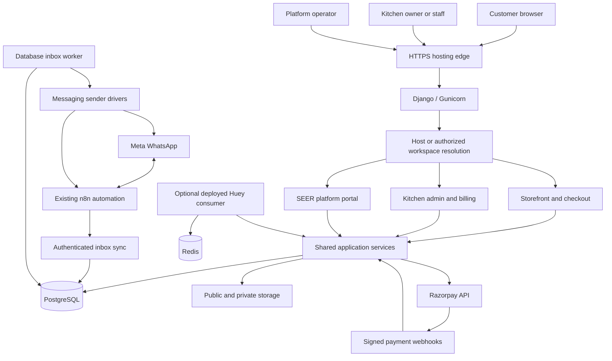
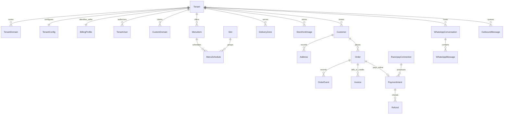
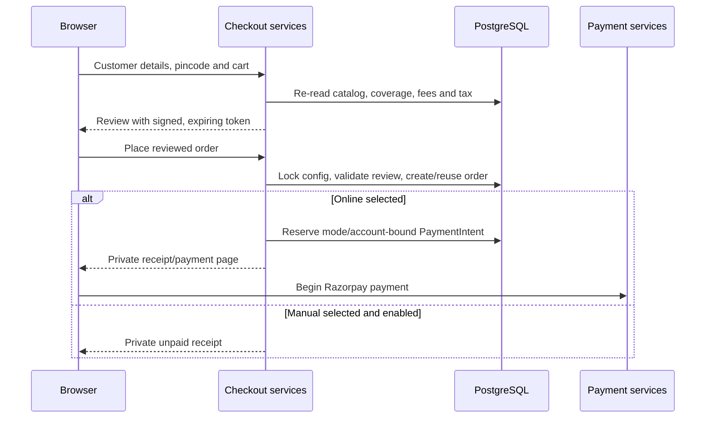
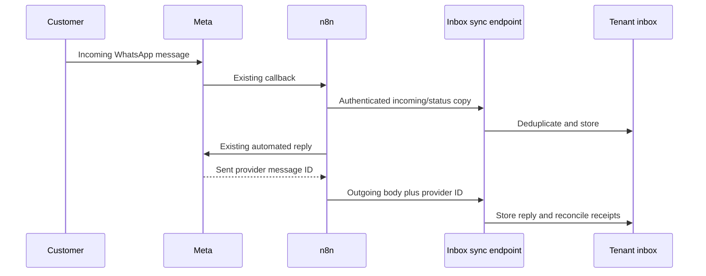

# SeerKitchen platform architecture

Implementation snapshot: **21 October 2026**, based on application commit
`bef0f9e` and its migrations. Annam Foods is the first tenant.

This document describes the code that exists, its boundaries, and the remaining
external setup. It does not certify the current Render deployment, live payment
account, DNS, or n8n workflow. The product roadmap is [docs/PLAN.md](docs/PLAN.md);
engineering invariants are in [AGENTS.md](AGENTS.md). Historical phase/status
notes may describe earlier checkpoints; this document is the current architecture
snapshot, not a declaration that every roadmap feature is finished.

## 1. Product and architectural shape

SeerKitchen is a hosted, multi-tenant platform for cloud kitchens. A platform
operator provisions kitchens. Kitchen owners manage their own storefront,
catalog, delivery coverage, orders, conversations, bills and settings. Customers
browse and order on the kitchen's website.

The architecture is a **modular Django monolith**: one application codebase,
shared PostgreSQL database, tenant-scoped models, server-rendered pages and
progressively enhanced JavaScript. There is no separate SPA, per-client code fork,
per-tenant deployment requirement, or WordPress runtime dependency.



Razorpay handles payment instruments; the platform stores provider references
and verified financial state, not card, UPI PIN or bank login credentials.
Existing n8n automation can remain responsible for WhatsApp replies while the
platform mirrors incoming messages, outgoing replies and delivery/read statuses.

## 2. Users, permissions and entry points

| Actor | Main access | Boundary |
| --- | --- | --- |
| Customer | Public storefront, cart, checkout, private receipt/bill | No kitchen administration; receipt belongs to the purchasing browser session |
| Kitchen staff/manager | Assigned kitchen management, inbox, order and billing tools | Membership scoped to that kitchen; sensitive owner actions are separately restricted |
| Kitchen owner | Kitchen management plus custom domains, payment credentials and refunds | Cannot administer another kitchen without membership |
| Platform superuser | Central kitchen provisioning and administration | Explicit cross-tenant access; not an ordinary customer role |

Django user accounts are shared between the central and kitchen login entry
points. `TenantUser` connects an account to a kitchen with `owner`, `manager` or
`staff` role. Separate screens do not imply separate account databases.

- **SEER login:** `/platform/login/`. Superusers go to platform administration;
  an ordinary account assigned one kitchen opens that kitchen's admin; multiple
  memberships show the kitchen picker.
- **Kitchen branded login:** `/manage/login/` on its own hostname. Opening
  `/manage/` while signed out reaches that login and successful authentication
  stays in that kitchen's admin.
- **Billing login:** `/billing/login/` remains a separate entry point using the
  existing accounts and kitchen access rules.
- **Django admin:** `/admin/` is limited to `PLATFORM_HOST`. The custom kitchen
  management interface is `/manage/`, not Django's unscoped admin.

Permission checks are enforced on the server. Knowing a slug, changing a URL or
hiding/showing a sidebar link does not grant kitchen membership. Domain changes,
Razorpay credentials and refund requests require owner/superuser permission.

### Route map

| Surface | Route pattern |
| --- | --- |
| Public kitchen website | `/`, `/menu/`, `/shop/`, `/item/<id>/`, `/p/<slug>/`, `/about/` |
| Cart and checkout | `/cart/`, `/checkout/` |
| Private receipt | `/checkout/complete/<uuid>/` |
| Private online payment and verification | Receipt path plus `payment/`, `pay/`, `verify/`, `status/` |
| Customer bill | Receipt path plus `bill/` |
| Kitchen admin | `/manage/` |
| Visual website editor | `/manage/appearance/` |
| Checkout coverage settings | `/manage/checkout-settings/` |
| Razorpay settings | `/manage/payments/razorpay/` |
| WhatsApp inbox and connection | `/manage/whatsapp/`, `/manage/whatsapp/settings/` |
| Billing portal | `/billing/` |
| Central kitchen picker | `/platform/` |
| Platform administration | `/platform/admin/` |
| Kitchen workspace | `/platform/workspaces/<slug>/` |
| Scoped management/billing | Workspace path plus `manage/` or `billing/` |
| Private storefront preview | Workspace path plus `preview/` |
| Kitchen domain settings | Workspace path plus `domains/` |
| Editor image asset | `/platform/assets/<slug>/<uuid>/` |
| Stable Razorpay webhook | `/platform/webhooks/<slug>/razorpay/test/` or `/live/` |
| Stable WhatsApp endpoints | `/platform/webhooks/<slug>/whatsapp/` and its `n8n/` suffix |
| Kitchen-host WhatsApp endpoints | `/webhooks/whatsapp/`, `/webhooks/whatsapp/n8n/` |
| Domain proof | `/.well-known/seerkitchen-domain` |
| Caddy certificate authorization | `/platform/domains/allow-certificate/` |
| Database health probe | `/healthz` |

The existing hosting address is `https://annam-foods.onrender.com/`. Its Annam
workspace is `/platform/workspaces/annam/`. These are existing addresses, not a
claim that a deployment was verified when writing this file.

## 3. Application boundaries

| Module | Responsibilities |
| --- | --- |
| `apps.tenancy` | Tenant identity/status, host mappings, configuration, encrypted legacy connections, billing profile, memberships, invitations, audit events, context and scoped managers |
| `apps.platform_portal` | Central login, provisioning, workspaces, private previews, custom-domain lifecycle and hosting adapters |
| `apps.catalog` | Categories, products/dishes, meal slots, weekly/dated schedules, availability and current prices |
| `apps.delivery` | Meal delivery zones, serviceable pincodes and separate courier checkout rules |
| `apps.content` | Pages, banners, design validation/publication, editor image storage and public-media fallback |
| `apps.storefront` | Public pages, theme registry, cart, checkout, private receipts and website context |
| `apps.orders` | Customer/address records, shared order creation/pricing, snapshots and fulfilment events |
| `apps.billing` | Staff booking entry, billing settings, payment confirmation, invoices, numbering, tax and credit notes |
| `apps.payments` | Razorpay account settings, provider adapter, payment verification, webhook handling, refunds and reconciliation |
| `apps.messaging` | Conversations, messages/receipts, authenticated ingestion, outbound queue, payload validation and sender drivers |
| `apps.owner` | Kitchen dashboard and management forms/views for catalog, content, orders and appearance |
| `apps.jobs` | Periodic message dispatch and per-kitchen local business-day handoff |
| `config` | Settings, root routing, WSGI and health checks |

Business services are Python calls shared by views and jobs. Internal modules
must not call each other through internal HTTP endpoints. Views parse/authorize
input and render responses; pricing, financial verification and state changes
belong in services. Templates must not calculate money or decide eligibility.

The `wordpress/` directory contains a separate review prototype. Its catalog,
plugins and database are not part of the Django production order/billing system.

## 4. Tenant isolation and request resolution

All kitchens share PostgreSQL. Most kitchen-owned records inherit
`TenantOwnedModel`, which provides a tenant foreign key and two managers:

```python
Order.objects.all()      # current tenant only; raises without context
Order.all_tenants.all()  # deliberate cross-tenant query
```

The context uses `ContextVar`; background work uses `tenant_context(kitchen)`.
Missing context raises `TenantContextMissing` rather than silently returning
another kitchen's rows. Global registry and explicitly exempt one-to-one models
are handled separately; exemptions require a stated reason. A test checks the
scoped-manager invariant across models.

Request resolution proceeds as follows:

1. Admit configured hosts, or an exact approved custom host through managed-domain
   admission. Never enable unrestricted wildcard customer hosts.
2. For a kitchen hostname, resolve `TenantDomain` to one kitchen. An unknown host
   does not select a default kitchen.
3. Central `/platform/` pages deliberately carry no implicit kitchen. Authorized
   workspace routes resolve the explicit slug and check membership.
4. Workspace management/billing/preview routes reuse their applications through
   a generated scoped URL configuration.
5. Exact public webhook routes resolve the explicit kitchen slug, then require
   their integration-specific authentication/signature.
6. Activate the kitchen context and configured timezone; restore both after the
   request, including exception paths.

Isolation is enforced by application code and tests, **not PostgreSQL row-level
security**. Explicit cross-tenant operations must remain narrowly scoped to
platform administration, dispatch/reconciliation sweeps and host lookup.

A verified primary custom domain can canonicalize public GET/HEAD browsing.
Staff tools, payment callbacks, webhooks and mutation requests retain their
original route so domain changes do not move credentials or replay operations.

## 5. Data model and sources of truth



The diagram shows major relationships; it is not a complete database schema.
Every tenant-owned relationship must refer to records in the same kitchen.

| Record/group | Source of truth |
| --- | --- |
| `Tenant`, `TenantDomain` | Kitchen identity/status and active hostname routing |
| `TenantConfig` | Branding, timezone, feature flags, design versions and checkout policy |
| `TenantUser`, `OwnerInvitation` | Membership and single-use owner activation |
| `BillingProfile` | Legal seller identity, FSSAI/GST, tax/rounding and invoice setup |
| `TenantSecrets` | Encrypted messaging/provider settings and legacy connection values |
| `CustomDomain`, `PlatformAuditEvent` | Pending domain claims, proofs, connection state and audit trail |
| `Slot`, `MenuCategory`, `MenuItem`, `MenuSchedule` | Live catalog and scheduled meal availability |
| `DeliveryZone` | Active local meal coverage, fees and minimums |
| `Page`, `Banner` | Kitchen-written pages and offers |
| `StorefrontImage` | Tenant editor images stored as database binary content |
| `Order` | Placed line, customer/address, pricing, source and payment snapshots |
| `OrderEvent` | Fulfilment transition history |
| `InvoiceSequence`, `Invoice`, `InvoiceRequest` | Financial-year numbering, immutable bills/credits and bill requests |
| `RazorpayConnection`, `PaymentIntent`, `Refund`, `PaymentEvent` | Mode-bound provider account, verified payment/refund state and event deduplication |
| `WhatsAppConversation`, `WhatsAppMessage`, `WhatsAppReceipt` | Inbox history and delivery/read state |
| `OutboundMessage`, `WhatsAppForwardEvent` | Durable queued sending and automation forwarding |
| `DailyKitchenRun` | One local business-day handoff per kitchen/date |

Catalog data can change after an order. Historical order and invoice snapshots
must not be recomputed from today's product prices or seller details. Money uses
`Decimal`/decimal database fields. Conversion to integer paise is confined to the
payment-provider boundary.

## 6. Catalog, availability, cart and delivery

`MenuItem.fulfilment` separates two checkout models:

| Type | Coverage | Scheduling and pricing |
| --- | --- | --- |
| `scheduled` meals | Active kitchen delivery-zone pincodes | Meal slot/date, live schedule, cutoff, zone minimum and fee |
| `courier` shop goods | Explicit configured approved Tamil Nadu pincode list | Courier enabled, courier minimum and flat shipping fee |

Dated menu rows override recurring weekday rows. Inactive, unavailable or sold-out
items cannot be ordered. Checkout rechecks current prices, availability, slot
cutoffs and closed dates/windows. A visible product card is not an order promise.

The session cart is namespaced by tenant (`cart.<tenant_id>`). Its shape and
quantities are validated; quantity is capped at 99 per line. Prices are read
again from the live catalog/schedule. A cart contains one meal slot/date or
courier goods; mixed fulfilment is rejected.

Pincode is mandatory at checkout:

- Meals outside an active, matching delivery zone are rejected before order
  creation. Where a pincode matches multiple areas, the customer selects one.
- Shop delivery uses a separate approved exact-pincode allowlist. It does not
  assume every pincode starting with a Tamil Nadu prefix is serviceable.
- Courier checkout fails closed until enabled and configured. The owner must
  confirm actual courier coverage, fees and minimums.
- Website checkout does not silently offer pickup or bypass coverage for an
  out-of-zone customer. Staff booking collection is a separate workflow.

Feature definitions live in `apps/tenancy/features.py`; configured presets/flags
are not proof that every advertised future feature has an implemented workflow.

## 7. Visual storefront editor and themes

All tenants currently share the **Kitchen Classic** theme and trusted Django
section templates. Per-tenant settings customize that design without creating a
client-specific code branch. A second selectable storefront theme is future work.

The theme registry defines these sections: welcome hero, offers, daily menu,
kitchen highlights, shop categories, food favourites, popular products, product
spotlight, ordering story and contact/visit. Visibility and order are configurable.

The visual editor provides:

- A rendered website canvas with direct text/photo selection and side-panel editing.
- Allowlisted plain-text headlines, descriptions, button labels and footer copy.
- Upload/library image replacement, including independent left/middle/right
  contact-section photos, logo, hero, offer and product spotlight images.
- Section ordering/visibility, approved color/type/spacing/corner/layout choices.
- Desktop/phone previews, undo/redo, draft saving, publication and previous-design
  restoration.

`TenantConfig.storefront_design` stores draft, published, previous and revision
state. Concurrent saves use an optimistic revision check. Customers see the
published version; private rendering can show draft changes before publication.
The canvas renders actual Django storefront templates, not a disconnected mockup.
Its iframe messaging checks source/origin and the rendering endpoints require
kitchen access.

Customization selects trusted options; tenants cannot upload executable
JavaScript, arbitrary templates or an unrestricted HTML page builder. Operational
catalog, prices, availability and delivery policy remain in their own forms.

Footer phone, email, address, WhatsApp number and FSSAI copy can be edited through
the website editor. These customer-facing design overrides do **not** overwrite
the legal accounting `BillingProfile`. Contact links resolve the configured
website contact values consistently.

### Image persistence

Editor uploads are `StorefrontImage` database records, validated as JPG/PNG/WebP,
up to 3 MB and 25 megapixels, with a 100-image kitchen limit. Published design
references can be served publicly. Draft/unpublished images require authorized
kitchen access; another kitchen's image ID cannot be assigned to a design.

Legacy catalog, banner and brand uploads still use configured public media
storage. Selected imported recovery assets are bundled under
`static/public-media/`, including the restored Health Mix image. An existing
uploaded replacement takes precedence over that fallback. Bundling selected
files does not make every legacy upload durable on an ephemeral Render disk.

## 8. Website checkout lifecycle



Checkout collects customer name, Indian phone number, optional email, complete
address, city and pincode. Meals use the supported today/tomorrow selection and
slot rules. Server-side review includes delivery charges and billing tax/rounding.

The 30-minute signed review binds the kitchen, browser identity, cart/customer
input, pricing/coverage/tax snapshot and selected payment mode/key ID. A changed
cart, price, fee, policy or account requires a fresh review. Browser totals or
claims that payment succeeded are never accepted as financial evidence.

Order creation is transactional and idempotent through the review reference,
`Order.external_ref` uniqueness and locking. Duplicate submission returns the same
order. Replaying an old submission must not clear a newly changed cart.
Website orders use channel `web` and source `storefront`, then appear in the
shared orders list and Website billing section.

Receipt references are UUID-based and tied to a tenant-specific purchasing
browser session. There is no public order-number lookup or guest order history
unlocked merely by supplying a phone number. Customer/address snapshots avoid
exposing an existing customer's private account information to another guest.
Customer OTP/account login has not been implemented.

## 9. Order and fulfilment state

All entry channels share `Order`, pricing and billing:

- Website checkout.
- Staff-entered manual bookings.
- Staff-entered WhatsApp bookings, including the inbox's prefilled customer link.

The normal fulfilment progression is:

```text
placed → confirmed → preparing → out_for_delivery → delivered
   └──────── cancellation before a terminal state ───────→ cancelled
```

Transitions record `OrderEvent` history. Payment state is separate:
`pending`, `cod_pending`, `paid`, `failed`, `refunded`.
Delivery or acceptance alone never means payment was received. Cancelling an
order does not itself refund a payment. A capture arriving after cancellation
still records the funds and flags refund review without reopening fulfilment.

The services and staff order screens support status changes. Automatic customer
notifications for every operational transition and all production fulfilment
procedures still require completion/verification; feature flags alone do not
establish that those notifications are running.

## 10. Razorpay payments, verification and refunds

Each kitchen connects its own account. `RazorpayConnection` has separate test/live
rows, encrypted API/webhook secrets, a public Key ID and at most one enabled mode.
Only owners/superusers manage it. Legacy saved credentials are migrated into
**disabled** connections; migration does not silently enable payments.

Enabling a connection performs a read-only credential check. A new order's
`PaymentIntent` preserves its connection, mode, Key ID, exact paise amount and INR
currency. Switching the mode offered to new customers does not change old orders.
Replacing keys is blocked while open provider orders still need them.

### Payment flow

1. Reserve an intent for the website order.
2. Claim provider-order creation in the database; perform provider I/O outside
   the locked transaction.
3. Create the Razorpay order with the exact server total, a stable receipt and
   platform intent reference. An ambiguous timeout is reconciled by receipt;
   retry must not blindly create another provider order.
4. Render Razorpay Checkout using only public options and customer-entered prefill.
   The browser loads `https://checkout.razorpay.com/v1/checkout.js`.
5. Verify the browser signature against the **stored** provider order reference.
6. Independently fetch provider payment state and require the correct order,
   exact amount, INR, captured flag and captured status.
7. Serialize the financial transition. Authorization alone remains unpaid;
   delayed failure callbacks cannot downgrade a paid/refunded order.

Raw webhooks use mode-specific HMAC-SHA256 verification and a tenant/mode/event-ID
deduplication record. They independently fetch provider evidence before changing
financial state. Supported events are `payment.captured`, `payment.failed`,
`order.paid`, `refund.created`, `refund.processed` and `refund.failed`.

Payment intent states cover creation and ambiguous outcomes (`new`, `creating`,
`uncertain`, `error`, `ready`) and financial outcomes (`captured`, `refund_pending`,
`part_refunded`, `refunded`). These are service states; fulfilment remains separate.

The REST adapter uses fixed HTTPS provider endpoints, server-side authentication,
bounded timeouts, no redirects and sanitized errors. Secrets never enter browser
options, query strings or returned settings forms.

### Bills and test mode

Verified **live** capture attempts automatic invoice issuance. Incomplete billing
settings leave the verified payment recorded and a visible billing error; the
owner fixes the profile and generates the bill afterward. Test payments show
TEST labels and cannot produce real numbered bills. Staff cannot manually mark
an order with an online Razorpay intent as paid to bypass verification.

### Refunds

The owner-only UI requests a **full refund**, with an explicit reason and
confirmation. A `Refund` UUID identifies the request and provider idempotency key.
Preflight checks verify the payment and existing refunds. Unknown/pending outcomes
are reconciled rather than submitted as a fresh refund.

Refund state progresses through `requested`, `submitting`, `uncertain`, `pending`
and `processed` or `failed`. A provider payment's refunded amount alone does not
prove completion: fetched refund records must say `processed`. External partial
refunds are tracked for review and prevent a blind additional full refund.
A processed full refund creates the remaining credit-note balance when a real
bill exists, accounting for prior credits and repeated callbacks.

### Reconciliation and integration status

Customers can check status on their private receipt; owners can refresh provider
state from the order. The bounded management command below is available for an
external scheduler, suggested every 15 minutes:

```bash
python manage.py reconcile_razorpay
```

It reads/reconciles provider state and retries eligible bill completion; it does
not request a new charge or refund. The repository's Render blueprint does not
automatically deploy this cron job.

The integration has automated simulated provider tests and browser checks.
**A real Razorpay sandbox transaction has not been verified with Annam's keys.**
The kitchen must supply keys in secure admin settings, register the public test
webhook and validate end to end. Live use additionally requires account
activation/KYC, live credentials/webhook and explicit activation.
See [docs/razorpay.md](docs/razorpay.md).

## 11. Billing architecture

The billing portal separates Manual, Website and WhatsApp entry views but shares
orders, legal seller profile, tax rules, invoice numbering and issued documents.
A staff booking starts unpaid. Manual/COD payment confirmation records actual
receipt of funds; it is not bank or gateway verification.

Billing supports regular GST tax invoices, composition bill of supply and
unregistered bills, according to the configured profile. Pricing supports
inclusive/exclusive item tax, defaults/item rates, intra-state CGST/SGST,
inter-state IGST, delivery taxation and rounding. Configure accountant-approved
settings; existing business identity must not be populated with fake registrations.

Invoice issuance:

1. Requires an eligible paid order and complete seller settings.
2. Uses order/pricing data and immutable seller/buyer/line/payment snapshots.
3. Checks that the bill matches the paid order total; a settings change must not
   manufacture a different invoice amount.
4. Allocates the financial-year/series number in a transaction under a row lock.
5. Reuses the existing invoice on repeated issuance requests.

Issued numbered documents are not editable live catalog views. Corrections and
refund accounting use credit documents, not silent edits to old invoices.
Staff and eligible customers can view/print a shared bill layout; the browser's
Print / Save as PDF provides download. Private bill storage is configured, but a
complete background PDF-generation and automatic WhatsApp-bill-delivery pipeline
must not be inferred from that storage setting.

## 12. WhatsApp, n8n and messaging workers

The chosen integration retains the existing n8n automation. The minimum inbox
sync settings are **Meta phone number ID** and an encrypted **sync bearer token**.
When n8n keeps the Meta callback, an app secret/access token/new Meta callback is
not required merely to mirror messages into this inbox. Direct Meta webhook
verification or authenticated attachment/sending paths have their own connection
requirements; those are separate from the minimal sync form.



The outgoing copy is essential: delivery callbacks do not contain the reply body.
Status receipts can arrive before the outgoing message; persisted receipt state
is applied when its body arrives. Retry the copy node, not the actual send node.
The n8n sync endpoint never forwards the copy back into n8n, avoiding a loop.

The inbox displays tenant-scoped text, supported attachments, structured message
content and sent/delivered/read/failed states. Staff replies require the customer's
open 24-hour reply window and a configured sending connection. Media previews
need a server-side media connection; mirroring alone does not grant attachment
access. Old history is not automatically imported.

`apps.messaging` owns outbound payload validation, queue records and delivery
history. Its sender drivers support console/development, n8n and Meta Cloud.
Provider constraints are validated in payload builders. Failed delivery uses
bounded retries/backoff and stale-claim recovery; exhausted/permanent failures
are recorded rather than left indefinitely sending.

The database inbox worker processes forwarding events and staff inbox replies
without Redis. The broader outbound transactional dispatcher is a separate Huey
periodic job. Do not assume running the inbox worker also runs all scheduled
platform messages.

**Message mirroring does not create a billable order.** The inbox can open a
WhatsApp booking with customer details prefilled; staff select items and confirm
payment. Automatic structured n8n order import, full native chat ordering and
automatic bill delivery remain separate implementation/integration work.
Live sync of Annam's incoming/outgoing/status nodes still needs verification.
See [docs/n8n/inbox-sync.md](docs/n8n/inbox-sync.md) and the
[messaging ADR](docs/adr/0001-messaging-architecture.md).

## 13. Kitchen provisioning and custom domains

Platform superusers create kitchens, assign presets/configuration and create
single-use owner activation invitations. Invitations are shared by the operator;
automatic invitation email delivery is not established. Private workspace admin,
billing and preview work before public DNS is ready.

`TENANT_BASE_DOMAIN` can reserve a platform subdomain, but application records do
not themselves create wildcard DNS or certificates. Tenant lifecycle/status and
feature settings exist; automated SaaS subscription charging, commercial plan
limits and a full self-service signup/billing product are not completed merely
because kitchens have status fields.

### Domain lifecycle

Domain settings are WordPress-like owner-facing configuration with staged
activation:

```text
Add hostname → Verify ownership TXT → Prepare website DNS
→ Explicit connection request → Hosting registration + HTTPS proof
→ Active route → Explicit primary selection
```

Preparation is the default: `DOMAIN_CONNECTIONS_ENABLED=0`. Adding/verifying a
claim does not replace Annam's current website or immediately create public
routing. Annam's actual domain move remains deferred to the production launch.

- Each hostname (`example.com`, `www.example.com`) is a separate claim.
- Random TXT ownership tokens reserve/verify a hostname for one kitchen.
- DNS destination checks reject private/loopback/link-local targets.
- Hosting supports Render registration, Caddy on-demand TLS authorization or a
  manually configured edge.
- A bounded certificate-verified HTTPS probe uses checked public addresses,
  correct hostname/SNI and a nonce/HMAC application proof, without redirects.
- Only verified HTTPS activates `TenantDomain` routing. Making primary is another
  explicit action requiring a recent successful TLS check.
- Provider tokens remain platform secrets; owners do not receive the Render API key.
- Registrar DNS records, MX/email configuration and external CDN settings remain
  outside the application's automatic control.

The Render/Caddy adapters have simulated tests. A staging-domain check in the
actual hosting account is still required before production customer cutovers.
See [docs/custom-domains.md](docs/custom-domains.md).

## 14. Persistence, secrets and security boundaries

| Data | Storage | Operational requirement |
| --- | --- | --- |
| Tenant/catalog/order/bill/inbox/payment records | PostgreSQL | Durable database, backup and restore testing |
| Visual-editor uploaded photos | PostgreSQL binary records | Included in database backups; monitor size |
| Legacy dish/banner/brand uploads | Public media storage | Persistent disk or configured storage backend |
| Selected recovered images | Repository static assets | Fallback only, not general upload storage |
| CSS/JS/icons | Collected static files | Build `collectstatic`; WhiteNoise in production |
| Private bill artifacts if used | Private storage alias/root | Never expose as public media |
| Sessions | Django session backend | Browser session is part of private receipt access |
| API/webhook credentials | Encrypted database fields | Preserve `SECRETS_KEY`; never echo decrypted values |
| Huey broker | Redis | Deploy consumer/broker for scheduled jobs |

`SECRET_KEY` signs application tokens/cookies. `SECRETS_KEY` encrypts tenant
credentials using Fernet; supported long random environment strings are converted
to a deterministic valid key. Keep both stable across restarts. Losing/changing
the encryption key breaks decryption; a database backup without the key is not a
usable connection-credential backup.

Security controls include CSRF-protected browser mutations, server-side membership
checks, tenant scoping, signed checkout reviews, private receipt authorization,
raw-body webhook HMAC verification, event deduplication, safe provider errors,
validated content/image fields and hostname/DNS/HTTPS domain checks. Production
uses secure session/CSRF cookies, HTTPS redirect and HSTS. The provider-facing
webhooks are exceptions to browser CSRF because they authenticate separately.

No customer payment instrument credentials are stored. Avoid placing secrets,
private receipt URLs, raw provider payloads or customer details in logs. Gunicorn's
configured access format omits query strings; application/operator logging still
needs the same discipline. A comprehensive retention/deletion and operational
security policy remains a production responsibility.

## 15. Runtime and deployment

### Local development

The supported development stack is PostgreSQL plus Redis, not SQLite as the
normal application database. `compose.yaml` exposes PostgreSQL on
`127.0.0.1:5439` and Redis on `127.0.0.1:6389` with persistent Docker volumes.
Dependencies are defined in `pyproject.toml`/lock files and deployment requirements.
Django is in the supported 5.x range; Render declares Python 3.12.7.

```bash
cp .env.example .env
# Replace example secrets before use.
docker compose up -d postgres redis
uv sync
uv run python manage.py migrate
uv run python manage.py runserver 127.0.0.1:8000
# Separate consumers when needed:
uv run python manage.py run_whatsapp_worker
uv run python manage.py run_huey
```

Use `annam.localhost` for the kitchen and `admin.localhost` for the platform;
see [README.md](README.md) for local host and provisioning commands. Test data
is not a substitute for real kitchen registration/payment credentials.

### Render runtime currently defined by the repository

```text
build.sh
  ├─ install requirements
  └─ collectstatic
start.sh
  ├─ migrate database
  ├─ optionally launch seed/media restoration in background
  └─ scripts/serve_with_inbox.py
       ├─ Gunicorn: 2 workers, 60-second timeout, PORT or 10000
       └─ manage.py run_whatsapp_worker
```

The supervisor terminates the remaining child and exits if either child fails,
allowing the hosting service to restart the instance. It does not launch Huey or
the payment reconciliation scheduler. Optional seed jobs depend on seed variables;
review/disable bootstrap settings for production rather than treating import as
an ordinary customer request.

`/healthz` performs `SELECT 1` against the database and returns 503 on database
failure. A healthy probe does not prove payment, n8n, media storage, the inbox
worker or scheduled consumers are functioning.

| Deployment file | Intended role | Important limit |
| --- | --- | --- |
| `render.yaml` | Free demo web service and PostgreSQL | Service can sleep; `/tmp` media/private paths are ephemeral; verify current provider limits |
| `render.paid.yaml` | Paid service/database with persistent disk | Defines `/var/data` media/private storage; does not prove it has been deployed |
| `compose.yaml` | Local PostgreSQL/Redis foundation | Not a complete production web/proxy deployment |
| `deploy/Caddyfile.example` | Static/media serving and reverse-proxy example | Requires actual hosts, TLS/deployment setup and private-storage separation |

Production settings refuse startup without explicit database credentials,
`SECRET_KEY`, `SECRETS_KEY`, `ALLOWED_HOSTS` and `PLATFORM_HOST`. WhiteNoise serves
compressed manifest static assets. Public media can be served by the Django
handler or replaced by a deliberately configured external backend.

Free Render service sleep can delay storefront and webhook requests. The
repository does not establish an always-on production deployment or reliable
payment/webhook delivery simply by successfully pushing code.

### Configuration ownership

| Setting group | Where it belongs |
| --- | --- |
| Database, signing/encryption keys, allowed hosts, platform host | Server environment |
| Redis URL and consumer process | Deployment environment/process manager |
| Domain connection gate/target/provider and Render credentials | Server environment controlled by platform operator |
| Kitchen brand, theme, feature flags and timezone | Tenant configuration/admin |
| Local delivery zones and courier pincode/fee policy | Kitchen delivery/checkout settings |
| Legal identity, GST/FSSAI and invoice rules | Kitchen billing settings |
| Razorpay test/live keys and webhook secrets | Owner-only encrypted payment settings |
| Meta phone number ID and n8n mirror token | Kitchen inbox settings |
| Actual n8n copy nodes and Meta/Razorpay subscriptions | External service configuration |

Do not copy secret values into this document, Git or workflow exports.

## 16. Operations, failure handling and scaling

### Failure and recovery rules

| Failure | Expected behavior/recovery |
| --- | --- |
| Missing tenant context | Fail closed; repair caller context, never disable scoping |
| Stale checkout review | Re-review current cart/policy before placement |
| Duplicate order submission | Return the original order |
| Provider creation/refund timeout | Preserve uncertain state; reconcile reference, avoid new financial action |
| Bad/duplicate/stale payment callback | Reject or reuse safely; never trust browser state or downgrade verified payment |
| Paid order with incomplete bill settings | Keep paid state, surface billing error, repair profile and generate bill |
| Failed inbox copy | Retry copy using the same provider ID; do not resend the customer's reply |
| Worker crash | Recover stale claims; bounded retries and visible terminal failures |
| Encryption key mismatch | Fail closed; restore correct key, never expose/decrypt with a fallback guess |
| Failed domain DNS/TLS proof | Leave pending; keep existing primary/routing |
| Lost ephemeral upload | Recover from durable backup/bundled asset where available; fix storage |

### Backup and production operations

Back up PostgreSQL, public/private file storage and encryption/signing keys under
appropriate access controls. Test restoration into an isolated environment,
including image access, credential decryption, invoice history and tenant
isolation. Record deployment/migration versions and provider configuration.
Payment reconciliation and queued work require monitoring beyond HTTP uptime.

The current modular monolith can scale by separating web, inbox worker, Huey
consumer and scheduled reconciliation processes; using durable shared media;
scaling PostgreSQL appropriately; and adding observability. Financial row locks,
unique constraints and message leases remain necessary with multiple workers.
Do not move to per-tenant code copies as a scaling strategy.

A persistent disk is not automatically shared between multiple web instances.
Before horizontal scaling, move legacy public/private uploads to a compatible
shared storage design and verify asset permissions. Database-backed editor images
increase database/backup size and should be monitored.

## 17. What is implemented and what remains

### Whole cloud-kitchen platform

| Area | Current implementation | Remaining launch/product work |
| --- | --- | --- |
| Multi-tenancy | Shared database, scoped managers, host/workspace resolution, membership | Continue isolation checks on every new feature |
| Platform portal | Central login, kitchen picker/provisioning, owner activation, workspace preview | Complete production onboarding/operational procedures; invitations are manually shared |
| Kitchen management | Dashboard, catalog/content/delivery/settings, orders and inbox | Validate permissions and workflows with real kitchen staff |
| Website customization | Visual editor, text/photos/footer, draft/publish/restore, Classic layouts | Second theme; broader reusable section/template system if required |
| Custom domains | Preparation, TXT/DNS checks, hosting adapters, TLS proof, primary selection | Staging-provider verification and production cutover configuration |
| Payments | Tenant Razorpay test/live integration, verified captures and full refunds | Actual sandbox/live acceptance and deployed reconciliation/monitoring |
| Messaging | Inbox, authenticated n8n mirroring, sending infrastructure/workers | Live workflow validation, structured automatic order import and bill delivery |
| SaaS commercial controls | Tenant lifecycle/configuration foundation | Subscription collection, plan enforcement, self-service signup and commercial reporting |
| Infrastructure | Render blueprints, supervisor, PostgreSQL/Redis foundation | Always-on production service, durable storage, backup/restore and observability |

### Annam Foods, the first tenant

| Area | Finished in code | Still needed from configuration/acceptance or further work |
| --- | --- | --- |
| Storefront | Menu/shop/cart, offers, policies/pages, editable content/photos/footer | Final photo/copy/contact/policy and mobile review |
| Website checkout | Customer/address review, mandatory pincode, local/courier coverage, duplicate protection, private confirmation | Owner-confirmed pincodes, fees, cutoffs, holidays and courier rules; end-to-end acceptance |
| Razorpay | Secure settings, online checkout, verification/webhooks, live billing, full refund workflow | Enter real test keys, configure webhook/auto-capture and test; later live activation/KYC |
| Billing | Manual/website/WhatsApp bookings, payment confirmation, tax/numbering, printable bills/credits | Confirm actual legal/GST/FSSAI details and sample documents; automatic WhatsApp delivery remains |
| WhatsApp | Conversation inbox and n8n sync endpoints | Add/verify incoming, outgoing and status-copy nodes in the existing automation |
| WhatsApp orders | Staff booking from a conversation | Automatic structured import is not supplied by mirroring |
| Fulfilment | Order status services and admin controls | Validate actual accept/prepare/dispatch/deliver/cancel procedures and customer updates |
| Custom domain | Owner-facing setup/verification workflow | Deliberately defer mapping Annam's actual domain until production launch |
| Persistence | Database editor photos and selected recovered catalog assets | Durable legacy upload storage and tested restoration |

No real customer domain, n8n workflow or money movement is asserted to have been
changed merely because these features are implemented in the repository.

## 18. Verification and developer navigation

The preceding application checkpoint had **495 passing automated tests**,
including simulated Razorpay behavior. Those are code tests, not proof of a live
payment transaction. Run the suite and Django checks for the current checkout:

```bash
uv run python -m pytest -q
uv run python manage.py check
uv run python manage.py makemigrations --check --dry-run
```

Tests cover tenant isolation, catalog resolution, domain authentication/lifecycle,
editor draft/publication/image access, checkout eligibility/idempotency/privacy,
order/billing behavior, messaging ingestion/retries and payment capture/refund
verification. Before customer release, additionally verify the public deployment,
real provider sandbox, webhook retry behavior and production storage/restore.

| Read this source | For |
| --- | --- |
| [config/urls.py](config/urls.py) | Top-level routes and health check |
| [apps/tenancy/middleware.py](apps/tenancy/middleware.py) | Host/workspace resolution and context cleanup |
| [apps/tenancy/managers.py](apps/tenancy/managers.py) | Fail-closed query invariant |
| [apps/platform_portal/workspace_urls.py](apps/platform_portal/workspace_urls.py) | Reused scoped applications |
| [apps/storefront/themes.py](apps/storefront/themes.py) | Trusted theme/section/copy/image registry |
| [apps/content/services.py](apps/content/services.py) | Design validation, revisions, images and publication |
| [apps/storefront/checkout.py](apps/storefront/checkout.py) | Signed review and transactional placement |
| [apps/delivery/checkout.py](apps/delivery/checkout.py) | Explicit courier coverage policy |
| [apps/orders/services.py](apps/orders/services.py) | Shared order creation and transitions |
| [apps/billing/services.py](apps/billing/services.py) | Invoice issuance and financial documents |
| [apps/payments/services.py](apps/payments/services.py) | Verified captures, refunds and reconciliation |
| [apps/payments/provider.py](apps/payments/provider.py) | Bounded Razorpay HTTP adapter |
| [apps/messaging/worker.py](apps/messaging/worker.py) | Database inbox worker |
| [apps/jobs/tasks.py](apps/jobs/tasks.py) | Huey periodic entry points |
| [apps/platform_portal/domain_services.py](apps/platform_portal/domain_services.py) | Custom-domain lifecycle |
| [scripts/serve_with_inbox.py](scripts/serve_with_inbox.py) | Render process supervision |
| [docs/platform-stage-one.md](docs/platform-stage-one.md) | Platform operation and rollback context |
| [docs/custom-domains.md](docs/custom-domains.md) | DNS, provider and HTTPS setup |
| [docs/n8n/inbox-sync.md](docs/n8n/inbox-sync.md) | Existing automation mirroring instructions |
| [docs/razorpay.md](docs/razorpay.md) | Test/live setup and financial acceptance steps |

Update this architecture whenever a feature changes tenant boundaries, a source
of truth, a financial state transition, storage, deployment processes or an
external integration contract.
